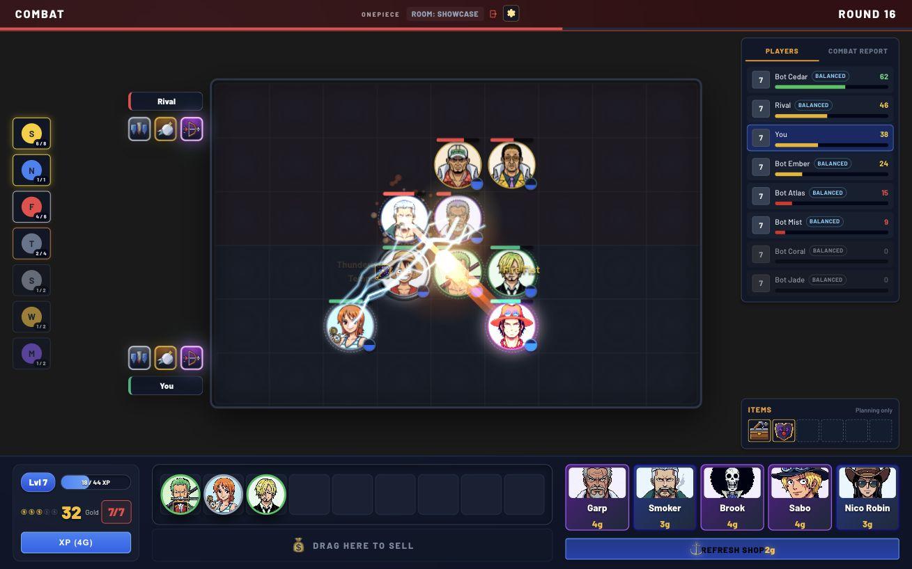
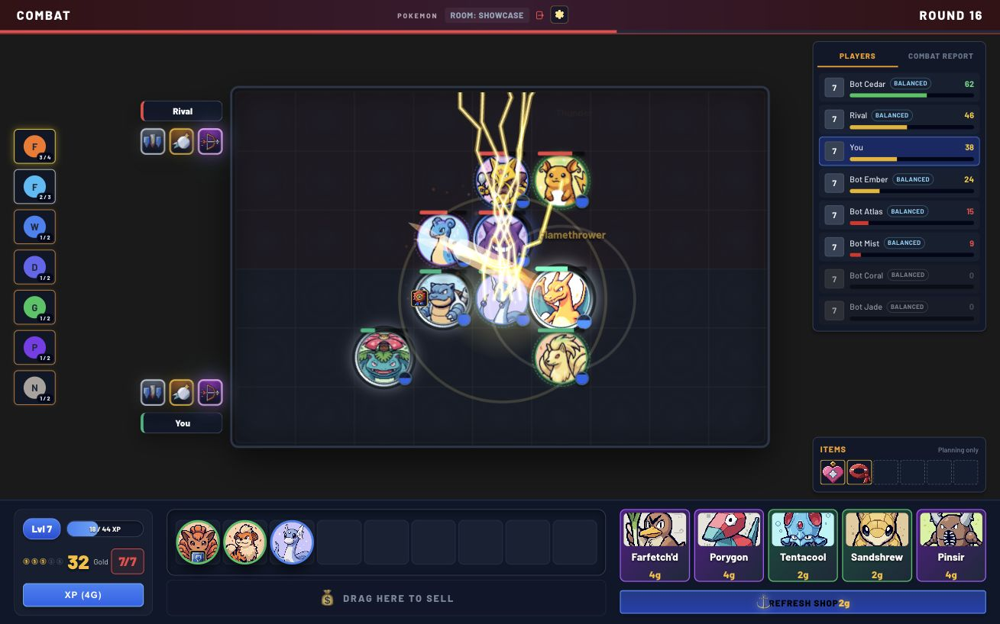
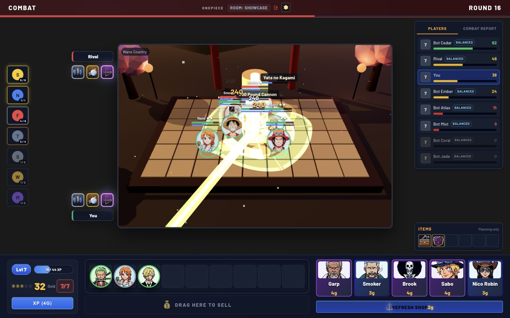
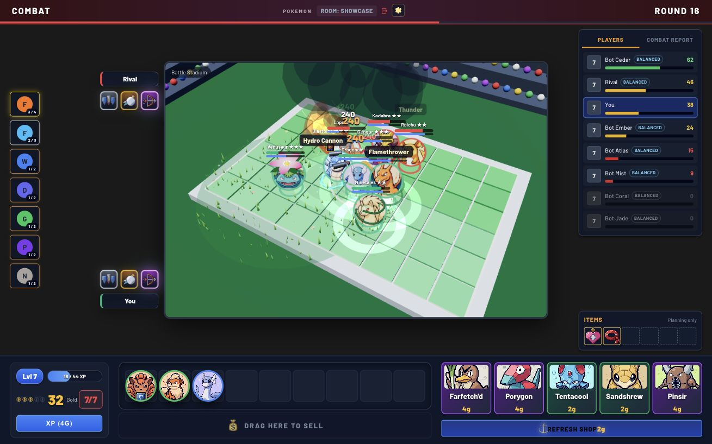

# Theme Fusion Tactics

**Build your team. Find your synergies. Watch the battle unfold.**

A fan-made auto-battler inspired by Teamfight Tactics. Recruit a One Piece crew or evolve a
Pokémon team, equip items, choose augments, and outlast seven opponents. Play solo offline
against bots, with Classic or optional 3D battles.

[Download TFT](https://github.com/kono94/theme-fusion-tactics/releases) ·
[Installation & help](desktop/README.md)

## Core features

- **Build a team with synergies.** Combine characters with shared traits to unlock team bonuses,
  and position tanks, damage dealers, and supports before they fight automatically.
- **Balance saving and spending.** Earn interest on saved gold, reroll for upgrades, or buy XP
  to field more units and improve your chances of finding expensive characters.
- **Upgrade your favourites.** Three matching 1★ units combine into a 2★; two matching 2★ units
  make a 3★. Pokémon can evolve into new forms with different abilities and roles.
- **Shape your build with items and augments.** Equip and move items freely during planning,
  and choose team-wide bonuses on rounds 3, 6, and 11.
- **Give each match a twist.** Choose One Piece or Pokémon in the lobby, then pick a match rule,
  let the game choose one randomly, or play with standard rules.
- **Play solo at your own pace.** Face seven bots that buy, save, and upgrade their own teams.
  Planning waits until you're ready; fight for first place and review your team in Match History.

## See it in action

| One Piece · Classic | Pokémon · Classic |
| --- | --- |
|  |  |

| One Piece · 3D Wano arena | Pokémon · 3D stadium |
| --- | --- |
|  |  |

Click an image for full size. Also see [items and the bench](docs/screenshots/planning-items.jpg)
and [augment selection](docs/screenshots/augment-selection.jpg).

## Download and play

Choose your installer under **Assets** on [GitHub Releases](https://github.com/kono94/theme-fusion-tactics/releases):

| Platform | Installer |
| --- | --- |
| Windows 64-bit Intel/AMD | `tft-windows-x64-VERSION.exe` |
| Mac with Apple Silicon (M1 or newer) | `tft-macos-arm64-VERSION.dmg` |

No Java, Python, Node, or Docker setup required. Use a current desktop browser.
These are unsigned previews; see the [installation guide](desktop/README.md#install-and-play)
for setup and security prompts. Intel Macs and Linux are outside this preview.

Open TFT, create a room, choose your theme, and start—empty seats fill with bots.
Enable **3D** in Settings for the arena view. The launcher handles game updates, and completed
solo matches stay in local Match History. Active matches aren't saved after quitting.

## Build or self-host

[Build & development guide](build/README.md) ·
[Hosted deployment](deployment/DEPLOYMENT_GUIDE.md) · [Contributor rules](AGENTS.md)

An educational fan project. One Piece, Pokémon, and their characters belong to their respective rights holders.
